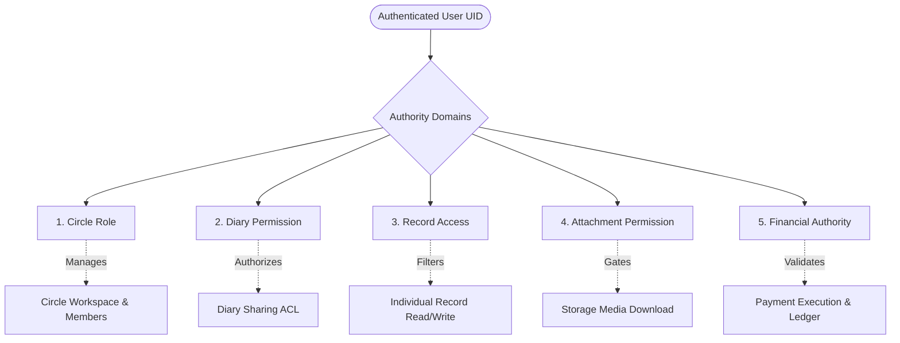
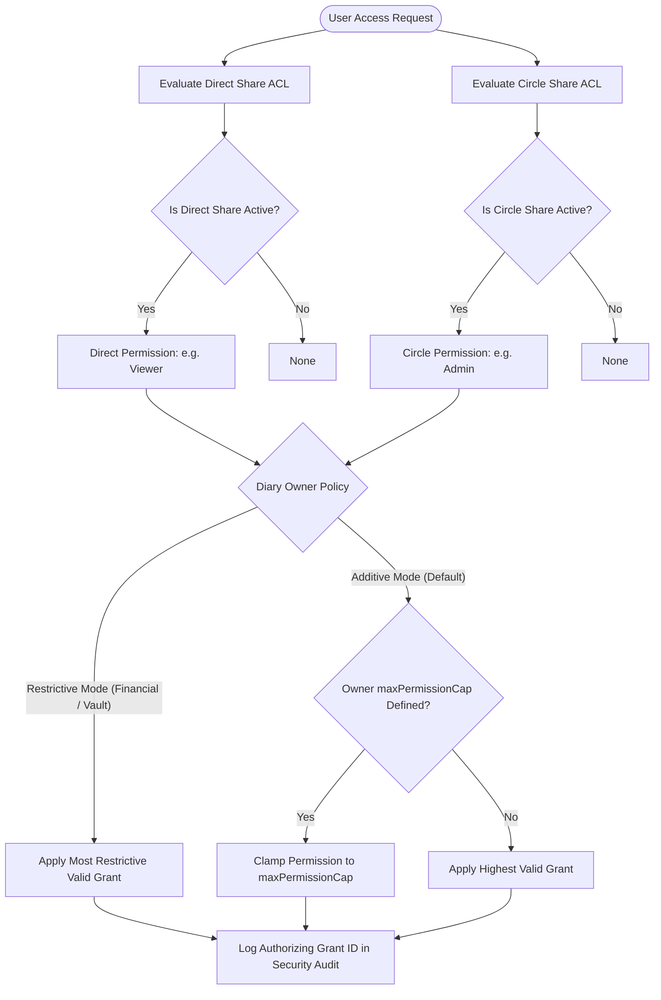
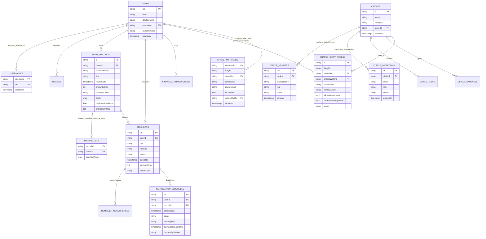
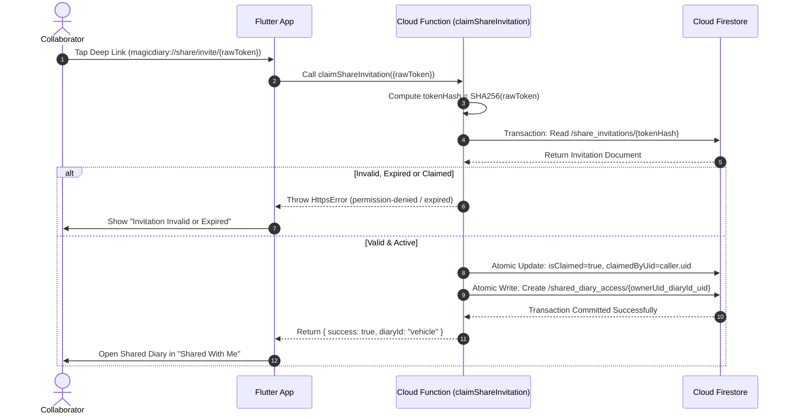
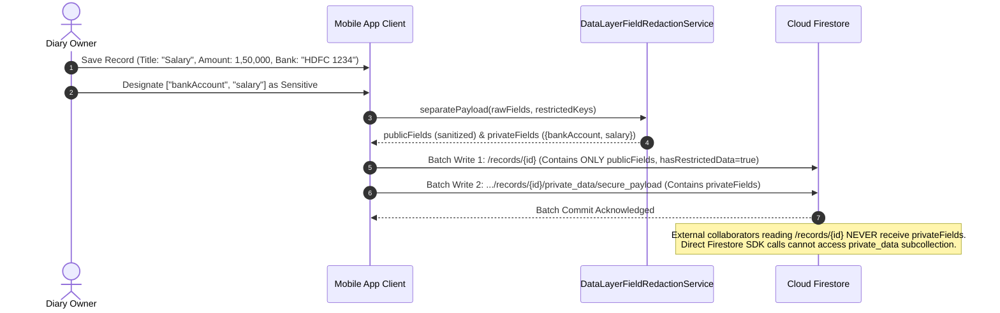
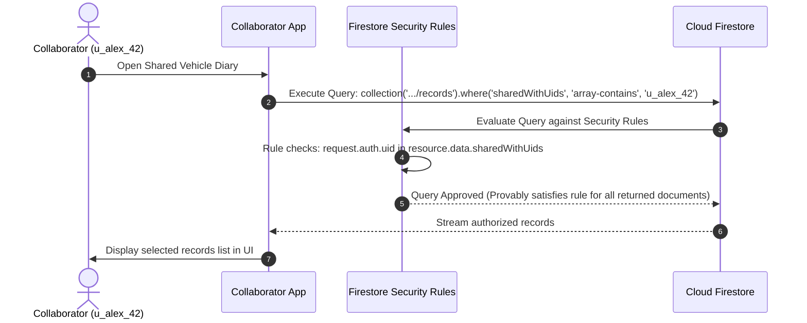
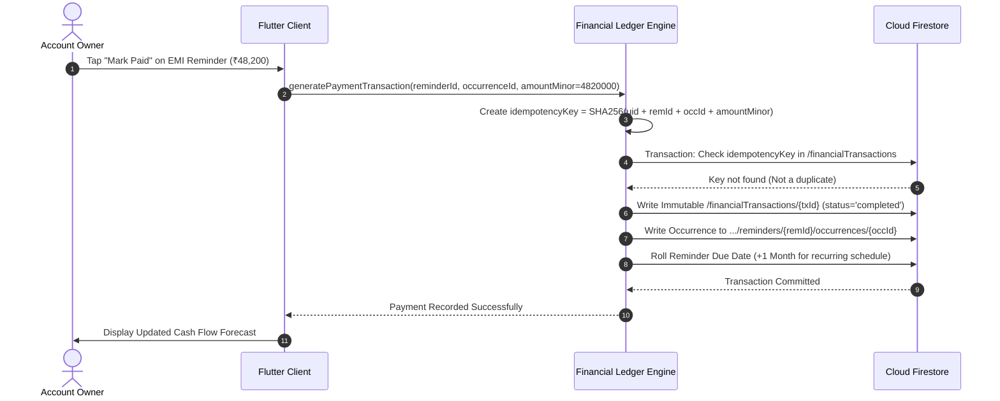
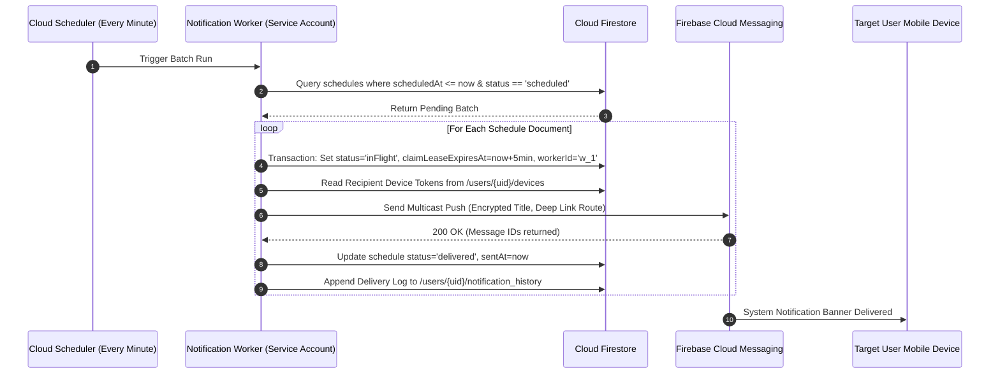

# Magic Diary — Hardened Firestore & Storage Schema, Architecture & Security Specification

> **Document Type:** Production Security Architecture & Database Blueprint  
> **Status:** Hardened Specification (Zero-Trust, RBAC, Data-Layer Redaction, Query-Compatible ACLs)  
> **Target Framework:** Google Cloud Firestore (Rules v2), Firebase Cloud Storage & Flutter (Dart 3 / Riverpod)  
> **Primary Security Principles:** Principle of Least Privilege, Write-Time Field Separation, Server-Enforced Authorization, Idempotent Financial Ledger, Defense-in-Depth.

---

## Table of Contents
1. [Security Architecture & Zero-Trust Principles](#1-security-architecture--zero-trust-principles)
   - [Separation of Authority Domains](#separation-of-authority-domains)
   - [Write-Time Sensitive Field Redaction & Public Projections](#write-time-sensitive-field-redaction--public-projections)
   - [Query-Compatible Selected-Record Sharing](#query-compatible-selected-record-sharing)
   - [Multi-Path Permission Resolution & Policy Caps](#multi-path-permission-resolution--policy-caps)
   - [Deep-Link Invitation Security & Backend Claim Engine](#deep-link-invitation-security--backend-claim-engine)
   - [Complete Firebase Storage Security Rules](#complete-firebase-storage-security-rules)
   - [Username Registry Privacy & Anti-Harvesting](#username-registry-privacy--anti-harvesting)
   - [App Check, Tokens & Server-Side Session Revocation](#app-check-tokens--server-side-session-revocation)
2. [Complete Firestore Schema Specification](#2-complete-firestore-schema-specification)
   - [Top-Level Collections](#top-level-collections)
   - [Decoupled Circle Architecture (/circles/{id}/members & invitations)](#decoupled-circle-architecture)
   - [User Subcollections (/users/{userId}/...)](#user-subcollections-usersuserid)
   - [Specialized Modules Subcollections](#specialized-modules-subcollections)
   - [Sample Hardened JSON Payloads](#sample-hardened-json-payloads)
3. [Financial Data Integrity & Idempotency](#3-financial-data-integrity--idempotency)
   - [Integer Minor Units (Paise / Cents) Standard](#integer-minor-units-paise--cents-standard)
   - [Idempotent Payment Engine & Immutable Audit Ledger](#idempotent-payment-engine--immutable-audit-ledger)
4. [Notification Worker Security & Leases](#4-notification-worker-security--leases)
   - [Least-Privilege Service Account IAM](#least-privilege-service-account-iam)
   - [Transactional Leases & Client Write Prohibitions](#transactional-leases--client-write-prohibitions)
5. [Account Deletion & Data Lifecycle](#5-account-deletion--data-lifecycle)
   - [Recursive Subcollection Purge](#recursive-subcollection-purge)
   - [Storage & Cross-Tenant Reference Eviction](#storage--cross-tenant-reference-eviction)
   - [Data Retention & Anonymization Policy](#data-retention--anonymization-policy)
6. [Entity Relationship Diagram (ERD)](#6-entity-relationship-diagram-erd)
7. [Hardened Flutter Data Models](#7-hardened-flutter-data-models)
   - [Dart Model Classes & Serializers](#dart-model-classes--serializers)
   - [Enums & Strongly-Typed Mappings](#enums--strongly-typed-mappings)
8. [End-to-End Data Flows & Sequences](#8-end-to-end-data-flows--sequences)
   - [Workflow 1: Backend Invitation Claim & ACL Generation](#workflow-1-backend-invitation-claim--acl-generation)
   - [Workflow 2: Write-Time Field Separation & Public Record Sync](#workflow-2-write-time-field-separation--public-record-sync)
   - [Workflow 3: Query-Compatible Selected-Record Query](#workflow-3-query-compatible-selected-record-query)
   - [Workflow 4: Immutable Payment Execution & Rollover](#workflow-4-immutable-payment-execution--rollover)
   - [Workflow 5: Server-Side Worker Lease & Notification Dispatch](#workflow-5-server-side-worker-lease--notification-dispatch)

---

## 1. Security Architecture & Zero-Trust Principles

### Separation of Authority Domains

To eliminate authority ambiguity and privilege cross-contamination, Magic Diary strictly decouples authority into **five independent domains**:



1. **Circle Role (`owner`, `admin`, `editor`, `contributor`, `viewer`)**:
   Controls membership management, task delegation, and workspace metadata inside `/circles/{circleId}`. *Does not automatically grant access to members' private diaries unless explicitly shared into the circle.*
2. **Diary Permission (`viewer`, `contributor`, `editor`, `admin`)**:
   Determines ability to read, contribute, or modify records within a shared diary scope.
3. **Record Access (`sharedWithUids`)**:
   Determines whether a specific record within a diary is readable by an external user under selected-record sharing.
4. **Attachment Permission (`allowAttachments`, default `false`)**:
   Explicit boolean gating Firebase Storage downloads for associated receipts, invoices, and photos. A user may have `editor` permission on a diary but `allowAttachments: false`.
5. **Financial Authority (`canExecutePayments`, default `false`)**:
   Authorizes recording payments, settling liabilities, or modifying financial obligations. Read-only diary viewers cannot execute or alter financial transactions.

---

### Write-Time Sensitive Field Redaction & Public Projections

#### The Critical Limitation of Firestore Security Rules
> **Fundamental Security Principle:** Cloud Firestore Security Rules **cannot** filter or redact specific fields from a document. If a user is authorized to read `/records/{recordId}`, they receive the **entire document payload over the network**. A client-side `restrictedFields` array or UI masking provides **zero** security against direct Firestore SDK queries or proxy inspection.

#### The Hardened Solution: Write-Time Data Separation
Restricted values are **never** written to the shared document. Data is separated at write-time into two distinct document trees:

```
/users/{ownerId}/diaries/{diaryId}/records/{recordId}
    ├── Public / Allowlisted Fields: title, recordDate, publicNote, sharedWithUids, etc.
    └── private_data/secure_payload (Subcollection)
            ├── Sensitive Fields: bankAccount, salary, medicalNotes, taxId
            └── Firestore Rule: allow read, write: if request.auth.uid == ownerId;
```

1. **Master Public Record**: Contains *only* non-sensitive fields approved for collaborator visibility.
2. **Private Data Subcollection (`.../records/{recordId}/private_data/secure_payload`)**:
   Contains all sensitive/restricted fields. Firestore security rules strictly prohibit any cross-tenant read or write to this subcollection:
   ```javascript
   match /users/{ownerId}/diaries/{diaryId}/records/{recordId}/private_data/{docId} {
     allow read, write: if isAuthenticated() && request.auth.uid == ownerId;
   }
   ```
3. **Collaborator Write Restrictions**:
   When contributors or editors update a shared record, security rules enforce an **allowlist schema check**:
   ```javascript
   function hasOnlyApprovedFields(data) {
     return data.keys().hasOnly(['id', 'ownerId', 'sourceDiaryId', 'title', 'subtitle', 
                                 'recordDate', 'status', 'tags', 'fields', 'updatedBy', 
                                 'updatedAt', 'sharedWithUids', 'schemaVersion']);
   }
   ```
   Collaborators are blocked from writing keys defined in `restrictedFieldKeys` back into the public `fields` map.

---

### Query-Compatible Selected-Record Sharing

#### The "Rules Are Not Filters" Dilemma
In Firestore, a query like:
```dart
FirebaseFirestore.instance.collection('users/$ownerId/diaries/$diaryId/records').get();
```
fails with `PERMISSION_DENIED` if security rules check `resource.data.id in grantedRecordIds`, because Firestore must evaluate the query against the rule **before fetching data**. It cannot filter out unauthorized documents automatically.

#### The Hardened Query Architecture
1. **Indexed Recipient Array (`sharedWithUids`)**:
   Every record shared under `selected` mode maintains an indexed array of authorized recipient Auth UIDs:
   ```json
   {
     "id": "rec_001",
     "title": "Brake Replacement",
     "sharedWithUids": ["u_alex_123", "u_sarah_456"]
   }
   ```
2. **Query Enforcement in Security Rules**:
   ```javascript
   match /users/{userId}/diaries/{diaryId}/records/{recordId} {
     allow read: if isOwner(userId)
       || (isAuthenticated() && request.auth.uid in resource.data.sharedWithUids)
       || (isAuthenticated() && hasEntireDiaryShare(userId, diaryId));
   }
   ```
3. **Client Query Structure**:
   Collaborators execute collection queries using an explicit `array-contains` clause that provably satisfies the rule:
   ```dart
   FirebaseFirestore.instance
     .collection('users/$ownerId/diaries/$diaryId/records')
     .where('sharedWithUids', arrayContains: currentUserId)
     .snapshots();
   ```
4. **Immediate Revocation**:
   Removing a collaborator's UID from `sharedWithUids` atomically and immediately revokes their ability to query or read the document.

---

### Multi-Path Permission Resolution & Policy Caps

When a user has access to a diary through both a **direct share** and a **circle share**, permissions must not blindly escalate.



#### Rules of Resolution:
1. **Independent Evaluation**: Direct grants and circle grants have separate document IDs and lifecycles. Revoking a circle membership does not terminate a direct grant, and revoking a direct grant does not compromise circle membership.
2. **Owner-Defined `maxPermissionCap`**:
   The diary owner can set `maxPermissionCap: 'contributor'` on the diary. Even if a circle grants `admin`, the effective collaborator permission is clamped to `contributor`.
3. **Audit Trail**: Every mutating write logs `authorizedByGrantId` (`direct_acl_123` or `circle_acl_456`) into the record metadata.

---

### Deep-Link Invitation Security & Backend Claim Engine

#### Attack Vector: Bearer Token Exploitation
A raw share token transmitted over deep links (`magicdiary://share/invite/{token}`) behaves like a bearer token. If intercepted, an unauthorized claimant could grant themselves access.

#### The Hardened Workflow:
1. **Cryptographic Token Entropy**:
   Tokens are generated using `Random.secure()` with 256 bits of entropy (Base64URL, minimum 43 characters).
2. **Hash-Only Storage (`tokenHash`)**:
   The raw token is **never** stored in Firestore. The backend stores `tokenHash: SHA256(rawToken)`.
3. **Server-Enforced Atomic Claim via Callable Cloud Function (`claimShareInvitation`)**:
   Clients **cannot** write to `/shared_diary_access` directly. Claiming is executed exclusively on the backend:
   ```typescript
   // Cloud Function: claimShareInvitation(rawToken)
   export const claimShareInvitation = onCall(async (request) => {
     const uid = request.auth.uid;
     const email = request.auth.token.email?.toLowerCase();
     const tokenHash = crypto.createHash('sha256').update(request.data.rawToken).digest('hex');
     
     return await db.runTransaction(async (tx) => {
       const inviteRef = db.collection('share_invitations').doc(tokenHash);
       const inviteSnap = await tx.get(inviteRef);
       
       if (!inviteSnap.exists) throw new HttpsError('not-found', 'Invalid invitation');
       const invite = inviteSnap.data();
       
       if (invite.isClaimed) throw new HttpsError('already-exists', 'Invitation already claimed');
       if (invite.expiresAt.toMillis() < Date.now()) throw new HttpsError('deadline-exceeded', 'Invitation expired');
       if (invite.boundEmail && invite.boundEmail !== email) {
         throw new HttpsError('permission-denied', 'Invitation is bound to a different email');
       }
       
       // 1. Mark invitation claimed atomically
       tx.update(inviteRef, {
         isClaimed: true,
         claimedByUid: uid,
         claimedAt: FieldValue.serverTimestamp()
       });
       
       // 2. Generate immutable ACL document
       const shareId = `${invite.ownerUid}_${invite.diaryId}_${uid}`;
       const aclRef = db.collection('shared_diary_access').doc(shareId);
       tx.set(aclRef, {
         id: shareId,
         diaryId: invite.diaryId,
         ownerUid: invite.ownerUid,
         sharedWithUid: uid,
         permission: invite.permission,
         sharingMode: invite.sharingMode,
         allowAttachments: invite.allowAttachments ?? false,
         status: 'active',
         createdAt: FieldValue.serverTimestamp()
       });
       
       return { success: true, diaryId: invite.diaryId };
     });
   });
   ```
4. **Rate Limiting & Anti-Bruteforce**:
   The function rejects requests exceeding 5 attempts per minute per UID/IP using Firebase App Check and Redis/Cloud Firestore rate-limiting counters.

---

### Complete Firebase Storage Security Rules

The following complete [storage.rules](file:///Volumes/DebasishApple/DeveloperExt/Apps/MagicDiary/storage.rules) enforces strict multi-tenant media authorization:

```javascript
rules_version = '2';

service firebase.storage {
  match /b/{bucket}/o {

    // Helper functions
    function isAuthenticated() {
      return request.auth != null;
    }

    function isOwner(userId) {
      return isAuthenticated() && request.auth.uid == userId;
    }

    function isValidFileSize() {
      return request.resource.size < 15 * 1024 * 1024; // 15 MB max
    }

    function isValidContentType() {
      return request.resource.contentType.matches('image/.*')
          || request.resource.contentType == 'application/pdf'
          || request.resource.contentType.matches('audio/.*');
    }

    function isCircleMember(circleId) {
      return isAuthenticated() && (
        firestore.get(/databases/(default)/documents/circles/$(circleId)).data.ownerId == request.auth.uid
        || firestore.exists(/databases/(default)/documents/circles/$(circleId)/members/$(request.auth.uid))
      );
    }

    function isCircleOwner(circleId) {
      return isAuthenticated() && 
        firestore.get(/databases/(default)/documents/circles/$(circleId)).data.ownerId == request.auth.uid;
    }

    // Validates that active, non-expired share exists with allowAttachments == true
    function canReadSharedDiaryAttachment(ownerId, diaryId) {
      let shareDocPath = /databases/(default)/documents/shared_diary_access/$(ownerId + '_' + diaryId + '_' + request.auth.uid);
      return isAuthenticated() && (
        firestore.exists(shareDocPath)
        && firestore.get(shareDocPath).data.status == 'active'
        && (
          !('expiresAt' in firestore.get(shareDocPath).data)
          || firestore.get(shareDocPath).data.expiresAt == null
          || request.time < firestore.get(shareDocPath).data.expiresAt
        )
        && firestore.get(shareDocPath).data.allowAttachments == true
      );
    }

    // 1. Shared Diary-specific attachments directory (gated by allowAttachments flag)
    match /users/{userId}/diaries/{diaryId}/attachments/{fileId} {
      allow read: if isOwner(userId) || canReadSharedDiaryAttachment(userId, diaryId);
      allow write: if isOwner(userId) && isValidFileSize() && isValidContentType();
      allow delete: if isOwner(userId);
    }

    // 2. User-isolated private directory (vault, personal receipts, avatars)
    match /users/{userId}/{allPaths=**} {
      allow read: if isOwner(userId);
      allow write: if isOwner(userId) && isValidFileSize() && isValidContentType();
      allow delete: if isOwner(userId);
    }

    // 3. Circle shared attachments directory - strictly gated to active member documents
    match /circles/{circleId}/{allPaths=**} {
      allow read: if isCircleMember(circleId);
      allow write: if isCircleMember(circleId) && isValidFileSize() && isValidContentType();
      allow delete: if isCircleOwner(circleId);
    }

    // Default deny for all unspecified storage paths
    match /{allPaths=**} {
      allow read, write: if false;
    }
  }
}
```

---

### Username Registry Privacy & Anti-Harvesting

#### Vulnerability Resolved:
Previous implementations stored user emails inside `/usernames/{username}`, allowing unauthorized discovery and scraping of user databases.

#### Hardened Specification:
1. **Zero-PII Storage**:
   `/usernames/{username}` contains **only** `uid` and `createdAt`. **Email, phone, and profile photo URLs are strictly prohibited**.
2. **Access Control**:
   - `read`: Restricted to authenticated users only.
   - `write`: Restricted to creating a document matching the caller's own UID during onboarding:
   ```javascript
   match /usernames/{username} {
     allow read: if isAuthenticated();
     allow create: if isAuthenticated() 
       && request.resource.data.keys().hasOnly(['uid', 'createdAt'])
       && request.resource.data.uid == request.auth.uid
       && !exists(/databases/$(database)/documents/usernames/$(username));
     allow update, delete: if false; // Usernames are permanent reservations
   }
   ```
3. **Lookup Rate Limiting**:
   Searching for usernames is mediated via a rate-limited Cloud Function or secure Firestore query that returns only public display badges, preventing dictionary enumeration of the 7-character namespace.

---

### App Check, Tokens & Server-Side Session Revocation

1. **Role of App Check**:
   App Check (Play Integrity on Android, DeviceCheck / App Attest on Apple) authenticates **client device integrity** against botnets and headless scrapers. It is an outer defense layer, **not** an authorization mechanism.
2. **True Authentication**:
   Every request must carry a valid, cryptographically signed Firebase Authentication ID token (JWT) verifying user identity.
3. **True Remote Logout & Refresh Token Revocation**:
   Deleting a local keystore or client document `/users/{uid}/sessions/{id}` does not revoke active Firebase ID tokens. To implement secure remote logout:
   - Call the backend endpoint `revokeUserSessions(uid)`.
   - The backend executes `admin.auth().revokeRefreshTokens(uid)`.
   - Cloud Firestore security rules inspect `request.auth.token.auth_time`:
     ```javascript
     function isSessionValid() {
       return request.auth.token.auth_time > (
         firestore.get(/databases/(default)/documents/users/$(request.auth.uid)/security/settings).data.tokensRevokedBefore.toMillis() / 1000
       );
     }
     ```

---

## 2. Complete Firestore Schema Specification

### Top-Level Collections

#### 1. `/users/{userId}`
Root profile document matching `request.auth.uid`.

| Field Name | Type | Constraints | Description |
| :--- | :--- | :--- | :--- |
| `email` | `string` | Required, Valid Email, Max 255 | Primary account email. |
| `displayName` | `string` | Required, Length 1..100 | Display name. |
| `username` | `string` | Required, Length 7, Alphanumeric | 7-character username (e.g. `BK7X9M2`). |
| `photoUrl` | `string` | Optional, Nullable, URL | Public avatar. |
| `currencyCode` | `string` | Required, Default: `INR`, Length 3 | ISO 4217 currency code (`INR`, `USD`). |
| `themeMode` | `string` | Required, `'system' \| 'light' \| 'dark'`| Visual theme preference. |
| `enableNotifications`| `bool` | Required, Default: `true` | Master push notification switch. |
| `createdAt` | `timestamp` | Required, Immutable | Account creation timestamp. |
| `updatedAt` | `timestamp` | Required | Last update timestamp. |

#### 2. `/usernames/{username}`
Fast lookup registry guaranteeing username uniqueness without exposing PII.

| Field Name | Type | Constraints | Description |
| :--- | :--- | :--- | :--- |
| `uid` | `string` | Required, Matches Auth UID | Owning user identifier. |
| `createdAt` | `timestamp` | Required | Reservation timestamp. |

---

### Decoupled Circle Architecture

To eliminate array overwrite collisions, email harvesting, and stale member access, Magic Circles use **dedicated subcollections**:

```
/circles/{circleId}                     <-- Metadata only (no emails or member arrays)
    ├── members/{uid}                   <-- Active authenticated members (Doc ID = Auth UID)
    ├── invitations/{inviteId}          <-- Pending invitations (Doc ID = Random ID)
    ├── tasks/{taskId}                  <-- Shared collaborative tasks
    └── expenses/{expenseId}            <-- Shared group expenses
```

#### 1. `/circles/{circleId}`
| Field Name | Type | Constraints | Description |
| :--- | :--- | :--- | :--- |
| `id` | `string` | Required, Doc ID | Unique Circle ID. |
| `name` | `string` | Required, Length 1..100 | Circle name. |
| `description` | `string` | Optional, Max 500 | Description. |
| `category` | `string` | Required, Enum | `family`, `household`, `travel`, `business`, `education`, `seniorCare`, `propertyManagement`, `friends`, `custom`. |
| `ownerId` | `string` | Required, Matches Owner UID | Circle creator. |
| `coverImageUrl` | `string` | Optional, URL | Cover banner image URL. |
| `createdAt` | `timestamp` | Required, Immutable | Created timestamp. |
| `updatedAt` | `timestamp` | Required | Last updated timestamp. |
| `schemaVersion` | `number` | Required, Value: `2` | Architecture schema version. |

#### 2. `/circles/{circleId}/members/{memberUid}`
*Document ID is strictly the authenticated member's Auth UID (`request.auth.uid`).*

| Field Name | Type | Constraints | Description |
| :--- | :--- | :--- | :--- |
| `uid` | `string` | Required, Matches Doc ID | Member Auth UID. |
| `displayName` | `string` | Required, Max 100 | Display name in circle. |
| `role` | `string` | Required, Enum | `owner`, `admin`, `editor`, `contributor`, `viewer`. |
| `status` | `string` | Required, Value: `'active'` | Member status. |
| `joinedAt` | `timestamp` | Required | Join timestamp. |
| `invitedBy` | `string` | Required, Auth UID | UID of user who issued invitation. |

#### 3. `/circles/{circleId}/invitations/{inviteId}`
*Pending invites are segregated completely from active membership.*

| Field Name | Type | Constraints | Description |
| :--- | :--- | :--- | :--- |
| `id` | `string` | Required, Doc ID | Unique invitation ID. |
| `circleId` | `string` | Required | Target circle ID. |
| `email` | `string` | Required, Valid Email | Invitee email address. |
| `role` | `string` | Required, Enum | Role granted upon acceptance. |
| `status` | `string` | Required | `pending`, `accepted`, `rejected`, `revoked`. |
| `invitedBy` | `string` | Required | Inviter Auth UID. |
| `expiresAt` | `timestamp` | Required | Expiration deadline (max 14 days). |
| `createdAt` | `timestamp` | Required | Created timestamp. |

---

### User Subcollections (`/users/{userId}/...`)

#### 1. Universal Life Records: `/users/{userId}/diaries/{diaryId}/records/{recordId}`
Master records powering all 45 personal diaries.

| Field Name | Type | Constraints | Description |
| :--- | :--- | :--- | :--- |
| `id` | `string` | Required, Doc ID | Record ID. |
| `ownerId` | `string` | Required, Matches `userId` | Owning user identifier. |
| `sourceDiaryId` | `string` | Required | Diary identifier (e.g., `vehicle`, `finance`). |
| `circleId` | `string` | Optional, Nullable | Associated Circle if linked. |
| `title` | `string` | Required, Length 1..250 | Record header. |
| `subtitle` | `string` | Optional, Max 250 | Secondary description. |
| `recordDate` | `timestamp` | Required | Event / occurrence date. |
| `amountMinor` | `number` | Optional, Integer >= 0 | Monetary value in minor units (paise/cents). |
| `currencyCode` | `string` | Required, Length 3 | ISO 4217 code (`INR`, `USD`). |
| `status` | `string` | Required | `active`, `completed`, `archived`, `pending`. |
| `tags` | `list<string>` | Optional, Max 20 | Categorization tags. |
| `fields` | `map<string, dynamic>`| Optional, Max 50KB | Non-sensitive, public custom fields. |
| `hasRestrictedData`| `bool` | Required, Default `false`| True if sensitive fields exist in subcollection. |
| `restrictedFieldKeys`| `list<string>`| Optional, Max 30 | Informational list of keys isolated in private subcollection. |
| `isPrivate` | `bool` | Required, Default `false`| If true, blocks all sharing unconditionally. |
| `sharedWithUids` | `list<string>` | Optional, Max 500 | Indexed UIDs authorized for selected-record sharing. |
| `attachmentIds` | `list<string>` | Optional | References to files stored in Cloud Storage. |
| `reminderId` | `string` | Optional | Associated reminder ID. |
| `remindBeforeDays` | `list<int>` | Optional | Advance alert schedule (e.g. `[30, 7, 1, 0]`). |
| `repeatSchedule` | `string` | Required | `one_time`, `daily`, `weekly`, `monthly`, `quarterly`, `yearly`. |
| `createdBy` | `string` | Required | Author UID. |
| `updatedBy` | `string` | Required | Last editor UID. |
| `createdAt` | `timestamp` | Required, Immutable | Created timestamp. |
| `updatedAt` | `timestamp` | Required | Modified timestamp. |
| `schemaVersion` | `number` | Required, Value: `2` | Data schema version. |

##### Subcollection: `/private_data/secure_payload`
*Strictly isolated confidential payload. Accessible ONLY by the document owner.*
- `recordId`: `string`
- `ownerId`: `string`
- `sensitiveFields`: `map<string, dynamic>` (contains bank accounts, passwords, salaries, medical data)
- `updatedAt`: `timestamp`

#### 2. Universal Reminders: `/users/{userId}/reminders/{reminderId}`
Standardized cross-module reminder entity.

| Field Name | Type | Constraints | Description |
| :--- | :--- | :--- | :--- |
| `id` | `string` | Required | Unique reminder ID. |
| `userId` | `string` | Required, Matches `userId` | Owning user UID. |
| `title` | `string` | Required, Length 1..200 | Reminder title. |
| `description` | `string` | Optional, Max 1000 | Context notes. |
| `module` | `string` | Required, Enum | `SchoolFees`, `Bills`, `Vehicle`, `Household`, `Property`, `Warranty`, `Finance`, `Personal`, `General`. |
| `status` | `string` | Required | `pending`, `due`, `overdue`, `snoozed`, `completed`, `paid`, `cancelled`. |
| `dueDate` | `timestamp` | Required | Target deadline. |
| `amountMinor` | `number` | Optional, Integer >= 0 | Monetary obligation in minor units. |
| `currencyCode` | `string` | Required, Default `INR` | ISO 4217 currency. |
| `actionRoute` | `string` | Optional | GoRouter route for quick actions. |
| `actionType` | `string` | Required | `mark_paid`, `mark_complete`, `mark_resolved`, `mark_acknowledged`, `custom`. |
| `priority` | `string` | Required | `high`, `medium`, `low`. |
| `assignedToUid` | `string` | Optional | Family/household assignee UID. |
| `snoozedUntil` | `timestamp` | Optional, Nullable | Snooze wake timestamp. |
| `completedAt` | `timestamp` | Optional, Nullable | Completion timestamp. |
| `completedByUid`| `string` | Optional, Nullable | User UID who completed task. |
| `occurrenceId` | `string` | Optional | Unique instance ID for recurring cycles. |
| `idempotencyKey` | `string` | Optional, Unique | Key preventing double-settlement. |
| `createdAt` | `timestamp` | Required | Created timestamp. |

##### Subcollection: `/occurrences/{occurrenceId}`
Historical completion ledger preserving audit trails.
- `occurrenceId`: `string`
- `scheduledDueDate`: `timestamp`
- `resolvedAt`: `timestamp`
- `resolvedByUid`: `string`
- `status`: `string` (`paid`, `completed`, `skipped`)
- `transactionId`: `string` (Link to canonical `/financialTransactions/{id}`)

#### 3. Worker-Secured Notification Schedules: `/users/{userId}/notification_schedules/{scheduleId}`
Discrete trigger documents queued for FCM delivery workers and local notification alarms.

| Field Name | Type | Constraints | Description |
| :--- | :--- | :--- | :--- |
| `id` | `string` | Required | Schedule ID. |
| `userId` | `string` | Required | Target recipient user UID. |
| `recordId` | `string` | Required | Source record reference. |
| `scheduledAt` | `timestamp` | Required | Trigger UTC timestamp. |
| `status` | `string` | Required | `scheduled`, `inFlight`, `delivered`, `failed`, `cancelled`. |
| `deliveryKey` | `string` | Required, Unique | Idempotency key: `{userId}_{recordId}_{offset}`. |
| `attemptCount` | `number` | Required, Int | Worker attempt counter. |
| `sentAt` | `timestamp` | Optional, Nullable | Worker delivery timestamp. |
| `claimLeaseExpiresAt`| `timestamp`| Optional, Nullable | Distributed worker mutex lease expiration. |
| `claimedByWorker`| `string` | Optional, Nullable | Worker instance holding active lease. |
| `localNotificationId`| `number` | Required, Int | Native mobile alarm notification ID. |
| `payload` | `map` | Required | Encrypted deep link and badge payload. |

---

### Specialized Modules Subcollections

| Collection Path | Primary Fields | Integrity & Storage Rules |
| :--- | :--- | :--- |
| `/products/{id}` | `name`, `brand`, `purchaseDate`, `priceMinor`, `hasWarranty`, `warrantyEndDate`, `invoiceStoragePath` | Invoices stored in `/users/{uid}/diaries/warranty/attachments/{id}` |
| `/vehicles/{id}` | `make`, `model`, `year`, `licensePlate`, `vin`, `odometer`, `insuranceExpiryDate`, `pucExpiryDate` | Regulated motor documents |
| `/children/{id}` | `name`, `dateOfBirth`, `gender`, `schoolId` | Child academic profile |
| `/feeStructures/{id}` | `childId`, `schoolId`, `academicYearId`, `totalAnnualFeeMinor`, `frequency` | Educational fee schedule |
| `/bills/{id}` | `accountId`, `billDate`, `dueDate`, `amountMinor`, `status`, `paymentTransactionId` | Utility bills with minor unit tracking |
| `/properties/{id}` | `propertyName`, `propertyType`, `address`, `purchasePriceMinor`, `taxDueDate` | Real estate assets and property records |
| `/domesticWorkers/{id}` | `name`, `role`, `phoneNumber`, `monthlySalaryMinor`, `joiningDate`, `isActive` | Domestic staff profiles |
| `/financialTransactions/{id}`| `type`, `amountMinor`, `date`, `category`, `paymentMethod`, `status`, `idempotencyKey` | Canonical immutable financial ledger |
| `/financialObligations/{id}` | `title`, `amountMinor`, `dueDate`, `frequency`, `nextDueDate`, `isAutomatic` | Cash flow forecasting engine |

---

### Sample Hardened JSON Payloads

#### Sample 1: Public Record Document (`/users/u_deb_99/diaries/vehicle/records/rec_veh_001`)
```json
{
  "id": "rec_veh_001",
  "ownerId": "u_deb_99",
  "sourceDiaryId": "vehicle",
  "circleId": null,
  "title": "Comprehensive Annual Service & Synthetic Oil Change",
  "subtitle": "Honda City (KA-01-MJ-5050)",
  "recordDate": "2026-11-15T04:30:00.000Z",
  "amountMinor": 845000,
  "currencyCode": "INR",
  "status": "completed",
  "tags": ["maintenance", "oil_change"],
  "fields": {
    "odometer": 42500,
    "serviceCenter": "Dakshin Honda, Bangalore",
    "workPerformed": "Synthetic engine oil replaced, brake pads inspected."
  },
  "hasRestrictedData": true,
  "restrictedFieldKeys": ["invoiceNo", "mechanicPersonalPhone", "internalCost"],
  "isPrivate": false,
  "sharedWithUids": ["u_alex_42"],
  "attachmentIds": ["att_veh_inv_9811"],
  "reminderId": "rem_veh_service_next",
  "repeatSchedule": "yearly",
  "createdBy": "u_deb_99",
  "updatedBy": "u_deb_99",
  "createdAt": "2026-11-15T05:00:00.000Z",
  "updatedAt": "2026-11-15T05:30:00.000Z",
  "schemaVersion": 2
}
```

#### Sample 2: Private Isolated Data (`.../records/rec_veh_001/private_data/secure_payload`)
```json
{
  "recordId": "rec_veh_001",
  "ownerId": "u_deb_99",
  "sensitiveFields": {
    "invoiceNo": "INV-2026-9811",
    "mechanicPersonalPhone": "+919876543210",
    "internalCost": 620000
  },
  "updatedAt": "2026-11-15T05:30:00.000Z"
}
```

#### Sample 3: Hardened Circle Member Document (`/circles/c_fam_01/members/u_alex_42`)
```json
{
  "uid": "u_alex_42",
  "displayName": "Alex Driver",
  "role": "editor",
  "status": "active",
  "joinedAt": "2026-11-15T06:00:00.000Z",
  "invitedBy": "u_deb_99"
}
```

---

## 3. Financial Data Integrity & Idempotency

### Integer Minor Units (Paise / Cents) Standard
To eliminate floating-point rounding errors and multi-currency inaccuracies:
- **All financial fields are stored as 64-bit integer minor currency units (`amountMinor`)**.
- Example (INR / USD):
  - ₹48,200.00 $\rightarrow$ `4820000` paise.
  - \$150.50 $\rightarrow$ `15050` cents.
  - Zero-decimal currencies (e.g. JPY) store exact whole units.

### Idempotent Payment Engine & Immutable Audit Ledger
1. **Idempotency Keys**:
   Every payment operation requires a unique client-generated key (`idempotencyKey = SHA256(userId + reminderId + occurrenceId + amountMinor)`). If a network timeout occurs, re-transmitting the request cannot trigger duplicate deductions.
2. **Immutability Principle**:
   Once a `/financialTransactions/{id}` document has `status: 'completed'`, **it is immutable**. Cloud Firestore security rules reject all `update` and `delete` operations:
   ```javascript
   match /financialTransactions/{txId} {
     allow read: if isOwner(userId);
     allow create: if isOwner(userId) && isValidTransactionPayload(request.resource.data);
     allow update, delete: if false; // Transactions are append-only
   }
   ```
3. **Reversal & Correction Accounting**:
   To adjust an erroneous payment, the client must post a new compensatory transaction:
   - `type: 'reversal'` or `type: 'adjustment'`
   - `originalTransactionId: 'tx_old_123'`
   - `reason: 'Incorrect billing amount recorded'`

---

## 4. Notification Worker Security & Leases

### Least-Privilege Service Account IAM
The Notification Background Worker (Python / Cloud Functions) executes with a dedicated Google Cloud Service Account (`magic-diary-notification-worker@...iam.gserviceaccount.com`).
- **Permissions**: Restricted to querying `/users/{uid}/notification_schedules`, reading active FCM tokens, and logging delivery results.
- **Client Lockdown**: Flutter mobile clients are strictly barred from updating worker metadata:
  ```javascript
  match /users/{userId}/notification_schedules/{scheduleId} {
    allow read: if isOwner(userId);
    allow create, delete: if isOwner(userId);
    // Clients can ONLY update user-controlled fields (snooze, cancel), NEVER worker delivery states
    allow update: if isOwner(userId) && (
      !request.resource.data.diff(resource.data).affectedKeys().hasAny([
        'status', 'attemptCount', 'sentAt', 'claimLeaseExpiresAt', 'claimedByWorker'
      ]) || request.resource.data.status in ['cancelled', 'dismissed']
    );
  }
  ```

### Transactional Leases & Client Write Prohibitions
To prevent duplicate push notification dispatch across horizontally scaled worker instances:
1. Worker queries pending schedules: `where('scheduledAt', '<=', now).where('status', '==', 'scheduled')`.
2. Worker acquires lease inside a Firestore transaction:
   ```typescript
   tx.update(scheduleRef, {
     status: 'inFlight',
     claimedByWorker: workerInstanceId,
     claimLeaseExpiresAt: Timestamp.fromMillis(Date.now() + 5 * 60 * 1000), // 5 min lock
     attemptCount: FieldValue.increment(1)
   });
   ```
3. After FCM returns 200 OK, worker marks `status: 'delivered'`, sets `sentAt: now`, and appends an entry to `/users/{uid}/notification_history`.

---

## 5. Account Deletion & Data Lifecycle

### Recursive Subcollection Purge
Firestore **does not** automatically cascade deletes down document subcollections. Deleting `/users/{userId}` leaves orphaned records in `/diaries`, `/reminders`, and `/private_data`.

The production account deletion workflow executes via a trusted Cloud Function (`deleteUserAccount`):
```typescript
export const deleteUserAccount = onCall(async (request) => {
  const uid = request.auth.uid;
  const bulkWriter = db.bulkWriter();

  // 1. Delete all user subcollections recursively using Firebase Admin Tools
  await db.recursiveDelete(db.collection('users').doc(uid), bulkWriter);

  // 2. Revoke and purge all outgoing and incoming sharing ACLs
  const outgoingShares = await db.collection('shared_diary_access').where('ownerUid', '==', uid).get();
  outgoingShares.forEach(doc => bulkWriter.delete(doc.ref));

  const incomingShares = await db.collection('shared_diary_access').where('sharedWithUid', '==', uid).get();
  incomingShares.forEach(doc => bulkWriter.delete(doc.ref));

  // 3. Purge circle memberships across all circles
  const memberships = await db.collectionGroup('members').where('uid', '==', uid).get();
  memberships.forEach(doc => bulkWriter.delete(doc.ref));

  // 4. Delete Cloud Storage bucket files
  const bucket = storage.bucket();
  await bucket.deleteFiles({ prefix: `users/${uid}/` });

  // 5. Release or tombstone username reservation
  const userProfile = await db.collection('users').doc(uid).get();
  if (userProfile.exists && userProfile.data().username) {
    bulkWriter.delete(db.collection('usernames').doc(userProfile.data().username));
  }

  // 6. Delete Authentication identity & revoke all active refresh tokens
  await auth.deleteUser(uid);
  await bulkWriter.close();
  return { success: true };
});
```

### Data Retention & Anonymization Policy
1. **Collaborative Circle Expenses**:
   In shared circles, expenses paid by the deleted user retain the historical financial figure but anonymize payer details:
   - `paidByUid` $\rightarrow$ `deleted_user`
   - `paidByName` $\rightarrow$ `Former Member`
2. **Audit Trails**:
   System access and security logs are retained in anonymized format for 90 days to comply with financial accounting and data protection regulations before automated TTL disposal.

---

## 6. Entity Relationship Diagram (ERD)



---

## 7. Hardened Flutter Data Models

### Dart Model Classes & Serializers

#### 1. `DiaryRecord` with Integer Minor Units & Array Indexing
```dart
class DiaryRecord {
  final String id;
  final String ownerId;
  final String sourceDiaryId;
  final String? circleId;
  final String title;
  final String? subtitle;
  final DateTime recordDate;
  final int? amountMinor; // Stored in minor currency units (e.g. paise)
  final String currencyCode;
  final String status;
  final List<String> tags;
  final Map<String, dynamic> fields; // Non-sensitive, public fields only
  final bool hasRestrictedData;
  final List<String> restrictedFieldKeys;
  final bool isPrivate;
  final List<String> sharedWithUids; // Query-compatible recipient array
  final List<String> attachmentIds;
  final String? reminderId;
  final List<int> remindBeforeDays;
  final String repeatSchedule;
  final String createdBy;
  final String updatedBy;
  final DateTime createdAt;
  final DateTime updatedAt;
  final int schemaVersion;

  const DiaryRecord({
    required this.id,
    required this.ownerId,
    required this.sourceDiaryId,
    this.circleId,
    required this.title,
    this.subtitle,
    required this.recordDate,
    this.amountMinor,
    this.currencyCode = 'INR',
    this.status = 'active',
    this.tags = const [],
    this.fields = const {},
    this.hasRestrictedData = false,
    this.restrictedFieldKeys = const [],
    this.isPrivate = false,
    this.sharedWithUids = const [],
    this.attachmentIds = const [],
    this.reminderId,
    this.remindBeforeDays = const [],
    this.repeatSchedule = 'one_time',
    required this.createdBy,
    required this.updatedBy,
    required this.createdAt,
    required this.updatedAt,
    this.schemaVersion = 2,
  });

  /// Convenience getter for display formatting
  double? get amountMajor => amountMinor != null ? amountMinor! / 100.0 : null;

  Map<String, dynamic> toMap() => {
    'id': id,
    'ownerId': ownerId,
    'sourceDiaryId': sourceDiaryId,
    'circleId': circleId,
    'title': title,
    'subtitle': subtitle,
    'recordDate': Timestamp.fromDate(recordDate),
    'amountMinor': amountMinor,
    'currencyCode': currencyCode,
    'status': status,
    'tags': tags,
    'fields': fields,
    'hasRestrictedData': hasRestrictedData,
    'restrictedFieldKeys': restrictedFieldKeys,
    'isPrivate': isPrivate,
    'sharedWithUids': sharedWithUids,
    'attachmentIds': attachmentIds,
    'reminderId': reminderId,
    'remindBeforeDays': remindBeforeDays,
    'repeatSchedule': repeatSchedule,
    'createdBy': createdBy,
    'updatedBy': updatedBy,
    'createdAt': Timestamp.fromDate(createdAt),
    'updatedAt': Timestamp.fromDate(updatedAt),
    'schemaVersion': schemaVersion,
  };

  factory DiaryRecord.fromMap(Map<String, dynamic> map, String id) {
    return DiaryRecord(
      id: id,
      ownerId: map['ownerId'] as String? ?? '',
      sourceDiaryId: map['sourceDiaryId'] as String? ?? '',
      circleId: map['circleId'] as String?,
      title: map['title'] as String? ?? '',
      subtitle: map['subtitle'] as String?,
      recordDate: (map['recordDate'] as Timestamp?)?.toDate() ?? DateTime.now(),
      amountMinor: (map['amountMinor'] as num?)?.toInt(),
      currencyCode: map['currencyCode'] as String? ?? 'INR',
      status: map['status'] as String? ?? 'active',
      tags: List<String>.from(map['tags'] ?? const []),
      fields: Map<String, dynamic>.from(map['fields'] ?? const {}),
      hasRestrictedData: map['hasRestrictedData'] as bool? ?? false,
      restrictedFieldKeys: List<String>.from(map['restrictedFieldKeys'] ?? const []),
      isPrivate: map['isPrivate'] as bool? ?? false,
      sharedWithUids: List<String>.from(map['sharedWithUids'] ?? const []),
      attachmentIds: List<String>.from(map['attachmentIds'] ?? const []),
      reminderId: map['reminderId'] as String?,
      remindBeforeDays: List<int>.from(map['remindBeforeDays'] ?? const []),
      repeatSchedule: map['repeatSchedule'] as String? ?? 'one_time',
      createdBy: map['createdBy'] as String? ?? '',
      updatedBy: map['updatedBy'] as String? ?? '',
      createdAt: (map['createdAt'] as Timestamp?)?.toDate() ?? DateTime.now(),
      updatedAt: (map['updatedAt'] as Timestamp?)?.toDate() ?? DateTime.now(),
      schemaVersion: (map['schemaVersion'] as num?)?.toInt() ?? 2,
    );
  }
}
```

#### 2. `PrivateRecordPayload` (Owner-Only Isolated Storage)
```dart
class PrivateRecordPayload {
  final String recordId;
  final String ownerId;
  final Map<String, dynamic> sensitiveFields;
  final DateTime updatedAt;

  const PrivateRecordPayload({
    required this.recordId,
    required this.ownerId,
    required this.sensitiveFields,
    required this.updatedAt,
  });

  Map<String, dynamic> toMap() => {
    'recordId': recordId,
    'ownerId': ownerId,
    'sensitiveFields': sensitiveFields,
    'updatedAt': Timestamp.fromDate(updatedAt),
  };

  factory PrivateRecordPayload.fromMap(Map<String, dynamic> map, String recordId) {
    return PrivateRecordPayload(
      recordId: recordId,
      ownerId: map['ownerId'] as String? ?? '',
      sensitiveFields: Map<String, dynamic>.from(map['sensitiveFields'] ?? const {}),
      updatedAt: (map['updatedAt'] as Timestamp?)?.toDate() ?? DateTime.now(),
    );
  }
}
```

#### 3. `CircleMember` (Subcollection Entity)
```dart
class CircleMember {
  final String uid;
  final String displayName;
  final CircleRole role;
  final String status;
  final DateTime joinedAt;
  final String invitedBy;

  const CircleMember({
    required this.uid,
    required this.displayName,
    this.role = CircleRole.contributor,
    this.status = 'active',
    required this.joinedAt,
    required this.invitedBy,
  });

  Map<String, dynamic> toMap() => {
    'uid': uid,
    'displayName': displayName,
    'role': role.name,
    'status': status,
    'joinedAt': Timestamp.fromDate(joinedAt),
    'invitedBy': invitedBy,
  };

  factory CircleMember.fromMap(Map<String, dynamic> map, String uid) {
    return CircleMember(
      uid: uid,
      displayName: map['displayName'] as String? ?? 'Member',
      role: CircleRole.values.firstWhere(
        (r) => r.name == map['role'],
        orElse: () => CircleRole.contributor,
      ),
      status: map['status'] as String? ?? 'active',
      joinedAt: (map['joinedAt'] as Timestamp?)?.toDate() ?? DateTime.now(),
      invitedBy: map['invitedBy'] as String? ?? '',
    );
  }
}
```

---

## 8. End-to-End Data Flows & Sequences

### Workflow 1: Backend Invitation Claim & ACL Generation



---

### Workflow 2: Write-Time Field Separation & Public Record Sync



---

### Workflow 3: Query-Compatible Selected-Record Query



---

### Workflow 4: Immutable Payment Execution & Rollover



---

### Workflow 5: Server-Side Worker Lease & Notification Dispatch



---

*This specification resolves all architectural weaknesses, closes data-layer leakage vectors, enforces query-compatible selected-record sharing, and establishes strict least-privilege security across the Magic Diary platform.*
