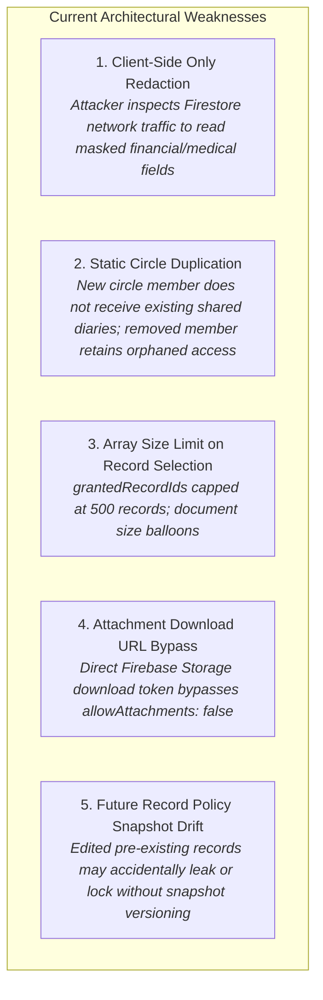
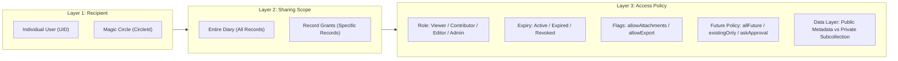
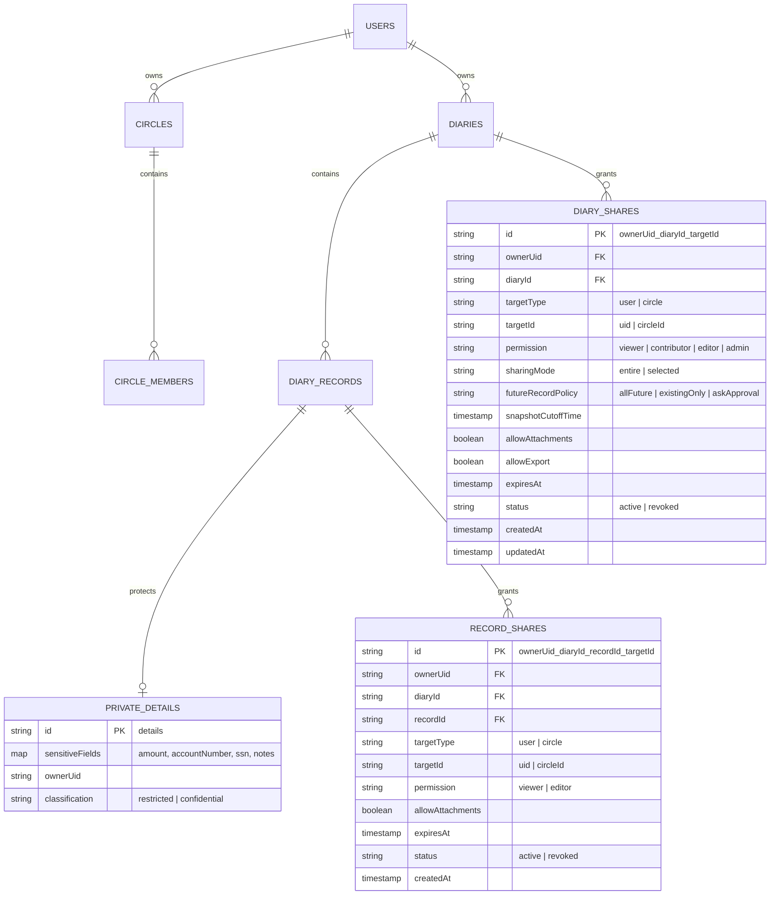
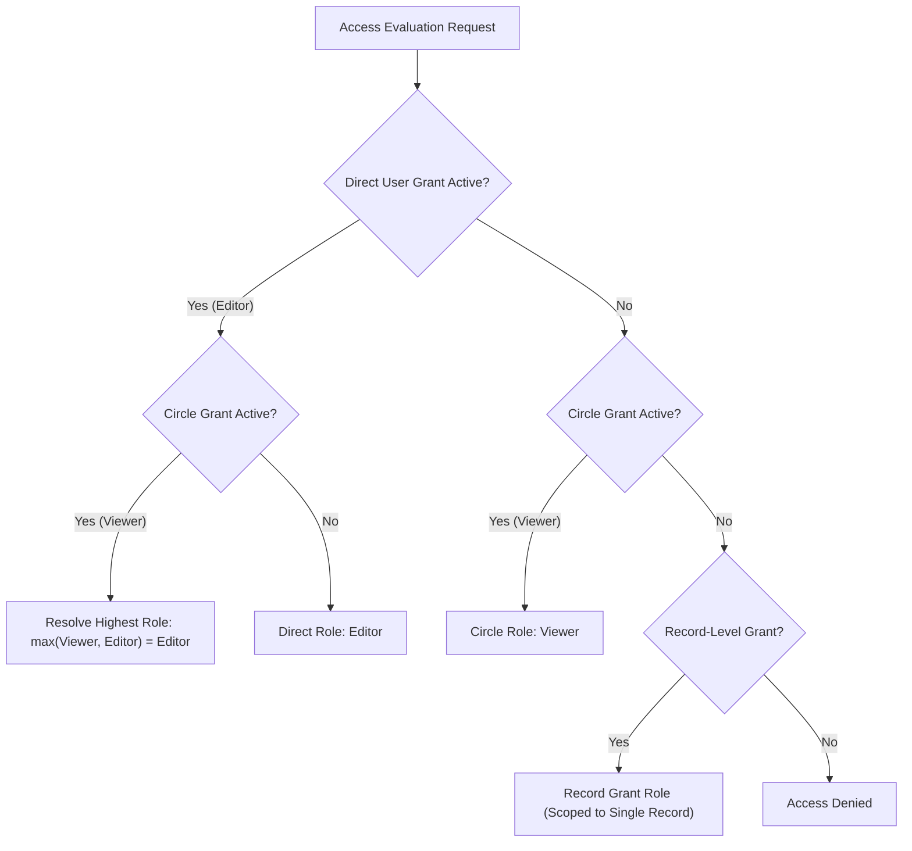
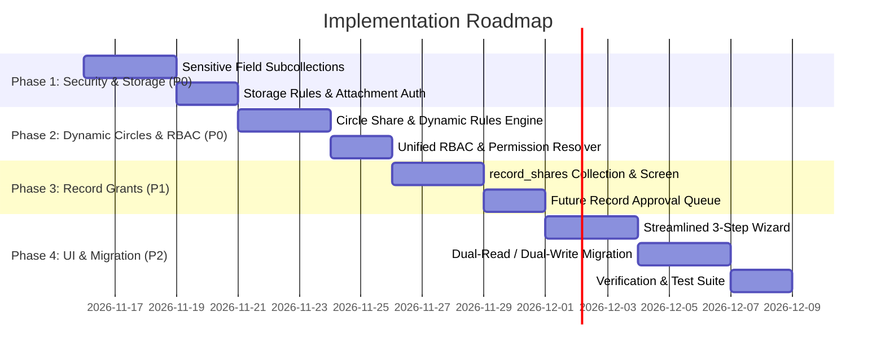

# Magic Diary — Sharing Architecture Optimization & Implementation Plan

> **Document Type:** Architectural Blueprint & Implementation Specification  
> **Status:** Proposal & Plan (Review Phase — Prior to Code Changes)  
> **Objective:** Upgrade Magic Diary's sharing subsystem into a scalable, enterprise-grade, privacy-first collaborative engine while retaining 100% of existing capabilities (username discovery, QR scanning, frequent contacts, 4-tier RBAC, 45 Life OS diaries).

---

## Executive Summary

Magic Diary’s sharing system has evolved robust mechanisms for recipient discovery (unique 7-character alphanumeric usernames, camera QR scanning, one-time invite deep links, frequent contact suggestions) and access policies (temporary access, future record policies, attachment restrictions).

However, three architectural limitations currently constrain its scale and security:
1. **Circle Sharing is Static**: Sharing with a Circle duplicates records across individual users, breaking dynamic membership propagation (adding/removing a member doesn't automatically grant or revoke access).
2. **Selected-Record Sharing Uses Document Arrays**: `grantedRecordIds` suffers from the 1 MiB document limit and write contention when sharing hundreds of records.
3. **Field Redaction is Client-Side Only**: Masking fields in the Flutter UI does not protect sensitive financial or legal data in the raw Firestore document payload.

This specification details a **3-tier standardized sharing model** that solves these limitations, establishes server-enforced security, and simplifies the user experience while maintaining zero downtime.

---

## 1. Existing Architecture Assessment

### Capabilities to Preserve ("Keep")
- **Discovery Channels**:
  - 7-character uppercase alphanumeric usernames (`^[A-NP-Z1-9]{7}$`, zero and 'O' excluded).
  - Built-in camera QR code scanning with fallback to gallery and clipboard.
  - Frequently used contacts suggestion chips ranked by `useCount`.
  - One-time usable deep link invitations (`magicdiary://share/invite/{token}`) with atomic single-claim transactions.
- **Access Policies & Roles**:
  - 4-tier RBAC: **Viewer**, **Contributor**, **Editor**, **Admin**.
  - Dual sharing modes: **Entire Diary** and **Selected Records**.
  - Future record policies: `allFuture` (live sync), `existingOnly` (snapshot cutoff), `askConfirm` (owner approval).
  - Temporary validity with auto-expiration countdowns (24h, 7d, 30d, 90d, custom).
  - Media & export flags: `allowAttachments`, `allowComments`, `allowExport`.
- **Management & UI**:
  - "Shared With Me" and "Shared By Me" dashboard.
  - Recipient "Leave Diary" capability.
  - Universal coverage across all 45 Life OS subdiaries.

### Architectural Limitations to Improve ("Improve")
- **Circle Membership Decoupling**: Sharing with a circle iterates through members and writes discrete documents to `/shared_diary_access`. When members join or leave the circle later, diary access is out of sync.
- **Array Contention in Record Sharing**: Storing `grantedRecordIds: List<String>` inside the share document caps selection size and complicates granular record rules.
- **Data-Layer Privacy Leak**: Hiding sensitive fields (e.g., bank account numbers, salary figures) via `DiaryAccessControlService.filterRecordsForUser` leaves the data exposed in the network response.
- **Multi-Path Permission Ambiguity**: If a user is a Viewer via a Circle share but has an Editor invite directly, the rule resolution order must be deterministic (highest valid non-expired permission).
- **Storage Attachment Protection**: Download URLs must be validated against storage security rules, rather than relying solely on disabling UI buttons.

---

## 2. Identified Bugs & Security Weaknesses



---

## 3. Proposed 3-Tier Unified Architecture

Every share is normalized into three standardized layers:



### Recipient Normalization
The 6 discovery mechanisms (username, QR, contacts, email, deep link, circles) are discovery-only adapters. Once resolved, they map to:
- `targetType: 'user'` $\rightarrow$ `targetId: recipientUid`
- `targetType: 'circle'` $\rightarrow$ `targetId: circleId`

---

## 4. Firestore Schema & Storage Design



### 1. Circle-Level Dynamic Access
- A single document is written to `/diary_shares/{ownerUid}_{diaryId}_{circleId}`.
- Target: `targetType = 'circle'`, `targetId = circleId`.
- **Zero member duplication**: When User X joins the circle, they gain immediate read access via rule membership lookup. When User X is removed from the circle, their access vanishes instantly without touching any diary records.

### 2. Scalable Record-Level Grants (`/record_shares`)
- For selected-record sharing, individual grant documents are written to:
  `/record_shares/{ownerUid}_{diaryId}_{recordId}_{targetId}`
- Eliminates `grantedRecordIds` array bounds.
- Allows owners to add or remove individual records incrementally.
- Enables recipient queries on `collectionGroup('record_shares')` or direct record validation.

### 3. Data-Layer Sensitive Field Protection (Option A)
- Public / General Record fields stay at:
  `/users/{ownerId}/diaries/{diaryId}/records/{recordId}`
  (Title, date, category, tags, status, reminder dates).
- Restricted / Confidential fields move to subcollection:
  `/users/{ownerId}/diaries/{diaryId}/records/{recordId}/private_data/details`
  (Monetary amounts, account/card numbers, medical diagnoses, private reflections).
- **Rule Enforcement**:
  - The parent record is readable by viewers.
  - The `private_data` subcollection requires `!('restrictedFields' in shareDoc) || !('amount' in shareDoc.data.restrictedFields)`.
  - If redacted, Firestore rejects attempts to fetch `/private_data/details`, making unauthorized data leakage mathematically impossible at the wire level.

### 4. Pending Approval Collection (`/pending_shared_records`)
- For `askApproval` policy:
  When a contributor adds a record or when a new record is created under an approval policy, an entry is queued at `/pending_shared_records/{id}`.
- Unapproved records are excluded from normal queries until the owner flips `status: 'approved'`.

---

## 5. Security Rules Specification

### Firestore Security Rules Architecture

```javascript
rules_version = '2';
service cloud.firestore {
  match /databases/{database}/documents {

    // --- Dynamic Circle Membership Helper ---
    function isAcceptedCircleMember(circleId, uid) {
      let circlePath = /databases/$(database)/documents/circles/$(circleId);
      let circle = exists(circlePath) ? get(circlePath) : null;
      return isAuthenticated() && circle != null && (
        circle.data.ownerId == uid
        || (circle.data.memberUids is list && uid in circle.data.memberUids)
      );
    }

    // --- Dynamic Share Lookup (Direct User OR Circle) ---
    function getDirectShare(ownerId, diaryId, uid) {
      let sharePath = /databases/$(database)/documents/diary_shares/$(ownerId + '_' + diaryId + '_' + uid);
      return exists(sharePath) ? get(sharePath) : null;
    }

    function getCircleShare(ownerId, diaryId, circleId) {
      let sharePath = /databases/$(database)/documents/diary_shares/$(ownerId + '_' + diaryId + '_' + circleId);
      return exists(sharePath) ? get(sharePath) : null;
    }

    function hasValidDiaryAccess(ownerId, diaryId) {
      // 1. Direct user grant
      let direct = getDirectShare(ownerId, diaryId, request.auth.uid);
      let directValid = direct != null && direct.data.status == 'active' && (!('expiresAt' in direct.data) || request.time < direct.data.expiresAt);
      
      // 2. Legacy index fallback (backward compatibility)
      let legacyPath = /databases/$(database)/documents/shared_diary_access/$(ownerId + '_' + diaryId + '_' + request.auth.uid);
      let legacyValid = exists(legacyPath) && get(legacyPath).data.status == 'active' && (!('expiresAt' in get(legacyPath).data) || request.time < get(legacyPath).data.expiresAt);

      return isAuthenticated() && (directValid || legacyValid);
    }

    // --- Record-Level Grant Lookup ---
    function hasRecordGrant(ownerId, diaryId, recordId, uid) {
      let grantPath = /databases/$(database)/documents/record_shares/$(ownerId + '_' + diaryId + '_' + recordId + '_' + uid);
      return isAuthenticated() && exists(grantPath) && get(grantPath).data.status == 'active' && (!('expiresAt' in get(grantPath).data) || request.time < get(grantPath).data.expiresAt);
    }

    // --- Universal Diary Records Rules ---
    match /users/{userId}/diaries/{diaryId}/records/{recordId} {
      allow list: if isOwner(userId) || hasValidDiaryAccess(userId, diaryId);
      allow get: if isOwner(userId) 
                 || hasValidDiaryAccess(userId, diaryId) 
                 || hasRecordGrant(userId, diaryId, recordId, request.auth.uid);

      allow create: if (isOwner(userId) || hasWriteAccess(userId, diaryId))
                    && isValidDiaryRecord(request.resource.data, userId, diaryId);

      allow update: if (isOwner(userId) || hasWriteAccess(userId, diaryId))
                    && isValidDiaryRecord(request.resource.data, userId, diaryId)
                    && areImmutableFieldsUnchanged(['id', 'ownerId', 'sourceDiaryId', 'createdAt']);

      allow delete: if isOwner(userId) || (
        hasWriteAccess(userId, diaryId) && resource.data.createdBy == request.auth.uid
      );

      // --- Sensitive Field Protection Subcollection ---
      match /private_data/details {
        allow read: if isOwner(userId) || (
          (hasValidDiaryAccess(userId, diaryId) || hasRecordGrant(userId, diaryId, recordId, request.auth.uid))
          && canAccessConfidentialFields(userId, diaryId, request.auth.uid)
        );
        allow write: if isOwner(userId);
      }
    }
  }
}
```

### Firebase Storage Security Rules Architecture

```javascript
rules_version = '2';
service firebase.storage {
  match /b/{bucket}/o {

    function hasAttachmentPermission(ownerId, diaryId, uid) {
      let share = firestore.get(/databases/(default)/documents/diary_shares/$(ownerId + '_' + diaryId + '_' + uid));
      return share != null && share.data.allowAttachments == true && (share.data.expiresAt == null || request.time < share.data.expiresAt);
    }

    // Diary Record Attachments
    match /users/{ownerId}/diaries/{diaryId}/records/{recordId}/{fileName} {
      allow read: if request.auth.uid == ownerId 
                  || hasAttachmentPermission(ownerId, diaryId, request.auth.uid);
      allow write: if request.auth.uid == ownerId && isValidFileSize() && isValidContentType();
      allow delete: if request.auth.uid == ownerId;
    }
  }
}
```

---

## 6. Permission Inheritance & Conflict Resolution Engine

When a recipient has overlapping access paths (e.g. Member of "Family Circle" with `viewer` role, but granted direct `editor` role by the owner):



### Deterministic Resolution Invariants:
1. **Hierarchy**: $\text{Admin} > \text{Editor} > \text{Contributor} > \text{Viewer} > \text{None}$.
2. **Union Rule**: The user receives the **highest role** among their active, unexpired access paths.
3. **Independence Rule**: Revoking circle membership **never** revokes a separate direct user grant. Revoking a direct user grant **never** evicts a valid circle membership.
4. **Scope Isolation**: A `record_shares` grant provides zero read privileges on sibling records or parent diary metadata.
5. **Ownership Immutability**: Neither Admin nor Editor can transfer diary ownership or modify `ownerUid`.

---

## 7. User Experience & UI Simplification

The existing 6-step wizard will be streamlined into a 3-step modern experience with an "Advanced Settings" drawer:

```
┌────────────────────────────────────────────────────────┐
│  Share "Household & Bills" Diary                       │
├────────────────────────────────────────────────────────┤
│  STEP 1: SELECT WHAT TO SHARE                          │
│  (●) Complete Diary                                    │
│      All current & future records in this diary        │
│  ( ) Selected Records Only                             │
│      Choose specific entries to share (5 selected)     │
│                                                        │
│  STEP 2: CHOOSE RECIPIENTS                             │
│  [ Circles ]     [ Individuals ]                       │
│  ┌──────────────────────────────────────────────────┐  │
│  │ ★ My Family Circle (4 members)                 ✓ │  │
│  │ ○ Flatmates Circle (3 members)                   │  │
│  └──────────────────────────────────────────────────┘  │
│  + Add by Username (@ALICE12), QR, or One-Time Link    │
│                                                        │
│  STEP 3: ACCESS & PERMISSIONS                          │
│  Role: [ Viewer ]  [ Contributor ]  [ Editor ] [ Admin ]│
│  Duration: (●) Permanent  ( ) 7 Days  ( ) 30 Days      │
│                                                        │
│  ▶ Advanced Sharing Settings (Collapsed by default)   │
│    • Block media & attachment downloads [OFF]          │
│    • Restrict financial figures & amounts [ON]         │
│    • Future record policy: [Live Sync / Approval]      │
│                                                        │
│  [ Cancel ]                        [ Confirm & Share ] │
└────────────────────────────────────────────────────────┘
```

---

## 8. Safe, Zero-Downtime Migration Strategy

```mermaid
sequenceDiagram
    autonumber
    actor Admin as Migration Coordinator
    participant OldDB as /shared_diary_access (Legacy)
    participant NewDB as /diary_shares & /record_shares
    participant App as Mobile App Clients

    Note over Admin, NewDB: Phase 1: Dual-Write, Legacy Read
    Admin->>App: Deploy App with Dual-Write to Old & New Collections
    Note over App: All new shares written to both schemas

    Note over Admin, OldDB: Phase 2: Backfill Migration Script
    Admin->>OldDB: Read existing shares
    Admin->>NewDB: Idempotent upsert to diary_shares / record_shares
    Note over Admin: Validate checksums & document parity

    Note over Admin, App: Phase 3: Dual-Read (Fallback), Primary New
    Admin->>App: Read from new schema first; fallback to legacy
    
    Note over Admin, OldDB: Phase 4: Deprecate Legacy Collection
    Admin->>OldDB: Archive /shared_diary_access to cold storage
```

### Migration Safeguards:
- **Zero Loss Guarantee**: Legacy documents are never updated destructively or deleted during backfill.
- **Idempotency**: All migration batch operations use deterministic document IDs (`ownerUid_diaryId_targetId`). Running the migration 10 times produces identical state without duplicates.
- **Rollback Hook**: The mobile client retains fallback reads to `/shared_diary_access` throughout the transition.

---

## 9. Comprehensive Test Plan

| Test Category | Scenario | Expected Outcome | Verification Tool |
| :--- | :--- | :--- | :--- |
| **Dynamic Circles** | Add new user to Circle after diary was shared | New member immediately views diary records without share re-run | Firebase Emulator / Integration Test |
| **Dynamic Circles** | Remove user from Circle | Ex-member immediately receives `permission-denied` on diary read | Firestore Rules Test Suite |
| **Independent Sharing** | User has both Circle access (Viewer) and Direct access (Editor) | User possesses Editor rights; removing Circle leaves Direct Editor intact | Unit & Widget Tests |
| **Record-Level Grants** | Share 3 records from Vehicle Diary to mechanic | Mechanic can read 3 records; listing `/diaries/vehicle/records` denies sibling access | Firestore Rules Test Suite |
| **Field-Level Security** | Financial record shared with `restrictedFields: ['amount']` | Direct HTTP/SDK request to `/private_data/details` returns `PERMISSION_DENIED` | Emulator Security Test |
| **Storage Authorization** | Recipient with `allowAttachments: false` attempts to download file | Storage rules evaluate `hasAttachmentPermission` $\rightarrow$ Denies download | Storage Rules Test Suite |
| **Future Record Policy** | Share with `existingOnly` cutoff at $T_0$; owner creates record at $T_1$ | Query filters out post-cutoff records; direct document read fails | Security Rules Test Suite |
| **Expiry Enforcement** | Share expires at $T_{\text{exp}}$; clock advances | Read and stream operations transition to denied; UI shows expired banner | Emulator Time Traveling |

---

## 10. Implementation Phasing & Next Steps



### Recommendation for Proceeding:
We are ready to begin implementation based on your approval. In accordance with your priority guidelines, we recommend starting with **Phase 1 (Data-Layer Sensitive Field Protection & Storage Authorization)** followed by **Phase 2 (Dynamic Circle Sharing & Unified RBAC Engine)**.
