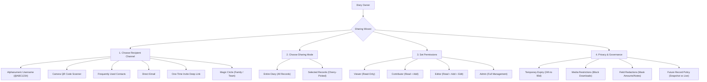
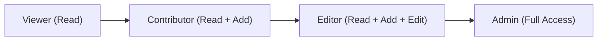
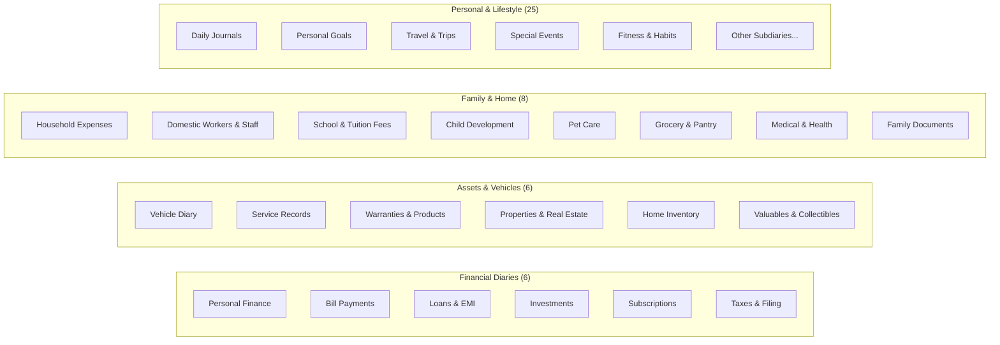

# Magic Diary — Supported Sharing Use Cases & Architecture Guide

Magic Diary provides an enterprise-grade, privacy-first collaborative sharing architecture designed for all 45 Life OS Subdiaries (Finance, Bills, Vehicles, Warranties, Household, Medical, Journals, and more).

This document outlines all currently supported sharing use cases, recipient channels, permission controls, and technical invariants.

---

## 1. Overview of Sharing Capabilities

---

## 2. Supported Recipient Discovery Channels

Magic Diary supports 6 distinct channels for sharing diaries and records:

| Channel | Identifier Format | Resolution Mechanism | Primary Use Case |
| :--- | :--- | :--- | :--- |
| **Username Search** | Exactly 7 characters, uppercase alphanumeric (`^[A-NP-Z1-9]{7}$`), no `0` or `O` | Fast $O(1)$ single-document lookup via `/usernames/{username}` with self-healing registry | Quick, privacy-preserving sharing without exchanging personal phone numbers or emails |
| **Camera QR Code Scanner** | Scans `magicdiary://user/{username}?uid={uid}&name={name}&email={email}` | Integrated camera scanner (`MobileScanner`) with flashlight, camera flip, gallery image analyzer, and clipboard fallback | Instant in-person sharing between two devices |
| **Frequently Used Contacts** | Auto-ranked contact list sorted by `useCount` descending | Stored in `/users/{ownerUid}/frequent_contacts/{contactId}`; updated automatically on each share | Rapid one-tap sharing with frequent family members or collaborators |
| **Email Address** | Standard email format (`name@domain.com`) | Direct UID/email resolution with pending invitation support (`pending_email`) | Sharing with team members or contacts before they register |
| **One-Time Invite Deep Link** | Unique cryptographically secure token (`magicdiary://share/invite/{token}`) | Single-use atomic claiming via Firestore transaction; auto-expires after claim or date cutoff | Sharing via WhatsApp, Telegram, SMS, or Slack where recipient identity is not known upfront |
| **Magic Circles** | Multi-member circles (`/circles/{circleId}`) | Auto-provisions individual `SharedDiaryAccess` records to all eligible circle members | Family households, flatmates, or shared project teams |

---

## 3. Sharing Modes & Granular Scopes

### Mode 1: Entire Diary Sharing (`SharingMode.entire`)
- Shares the entire subdiary (e.g., "Vehicle Maintenance", "Grocery Expenses", "Bill Payments").
- **Future Record Policies (`futureRecordPolicy`)**:
  - `allFuture`: **Live Sync**. The recipient automatically sees all new records added to this diary in the future.
  - `existingOnly`: **Static Snapshot**. Records created after the share cutoff time (`snapshotCutoffTime`) are automatically hidden from the recipient.
  - `askConfirm`: Requires owner confirmation before new entries are revealed to the recipient.

### Mode 2: Selected Records Sharing (`SharingMode.selected`)
- The owner cherry-picks individual records via the interactive `RecordSelectionScreen`.
- Features:
  - Multi-select checkboxes with bulk Select All / Deselect All.
  - Live search filtering by title, category, tags, or notes.
  - Date-range filtering.
  - "Shared with Others" indicators showing which records are already visible to other parties.
- The recipient's access is strictly constrained to the explicit list of record IDs (`grantedRecordIds`).

---

## 4. Role-Based Permissions (RBAC)

Magic Diary enforces 4 permission tiers across both UI widgets and Firestore Security Rules:

| Permission Level | Can View Records | Can Add New Entries | Can Edit Records | Can Delete Records | Can Manage Shares |
| :---: | :---: | :---: | :---: | :---: | :---: |
| **Viewer** | ✅ Yes | ❌ No | ❌ No | ❌ No | ❌ No |
| **Contributor** | ✅ Yes | ✅ Yes | ❌ No | ❌ No (Own entries only) | ❌ No |
| **Editor** | ✅ Yes | ✅ Yes | ✅ Yes | ❌ No (Own entries only) | ❌ No |
| **Admin** | ✅ Yes | ✅ Yes | ✅ Yes | ✅ Yes | ✅ Yes |

---

## 5. Security, Privacy & Data Governance

1. **Automatic Expiry (Temporary Access)**:
   - Configurable validity: 24 hours, 7 days, 30 days, 90 days, or a custom calendar date.
   - Enforced by both server rules (`request.time < resource.data.expiresAt`) and client visibility layers.
2. **Media Download Restrictions (`allowAttachments`)**:
   - When disabled, receipt photos, warranty cards, PDFs, and media attachments are masked and download buttons are disabled for the recipient.
3. **Data Export Restrictions (`allowExport`)**:
   - Controls whether the recipient can export the shared records to CSV, PDF, or JSON.
4. **Field-Level Redaction (`restrictedFields`)**:
   - Owners can redact specific sensitive fields (e.g. monetary amounts, account numbers, vendor notes) without hiding the entire record.
   - Enforced on client render via `DiaryAccessControlService.filterRecordsForUser`.

---

## 6. Supported Life OS Subdiaries (45 Categories)

All 45 Life OS Subdiaries in Magic Diary support universal sharing:

---

## 7. Lifecycle & Management Flows

1. **Managing Existing Shares**:
   - Access from Diary AppBar $\rightarrow$ **Settings** $\rightarrow$ **Manage Existing Shares** (`/manage-shares/{diaryId}`).
   - View active, pending, and expired shares.
   - Dynamically adjust permissions, add/remove records, toggle temporary expiry, or revoke access with one tap.
2. **Recipient Experience ("Shared With Me")**:
   - Accessible from the main bottom navigation / dashboard (`/shared-diaries`).
   - Dual-tab interface:
     - **Shared With Me**: Displays incoming shares with owner avatar, permission pill, scope chip, and expiration warning.
     - **Shared By Me**: Displays outgoing shares with recipient status and quick revoke options.
   - Category filter chips and sharing mode filters.
   - **Leave Diary**: Recipients can leave any shared diary at will without requiring owner intervention.

---

## 8. Firestore Security Rules Architecture

Shared access is governed by deterministic, $O(1)$ single-document lookups in Firestore:

- **Access Document Location**: `/shared_diary_access/{ownerUid}_{diaryId}_{target}`
- **Records Location**: `/users/{ownerUid}/diaries/{diaryId}/records/{recordId}`
- **Rule Enforcement**:
  - `allow list`: Permitted for authenticated owners OR recipients with valid, active access document (`hasSharedDiaryAccess`).
  - `allow get`: Permitted for authenticated owners OR recipients matching record-level policies (`canReadSharedRecord`).
  - `allow create/update`: Permitted for owners OR contributors/editors (`hasSharedDiaryWriteAccess`).
  - Immutability safeguards strictly protect `ownerUid` and `diaryId` against unauthorized modification.
